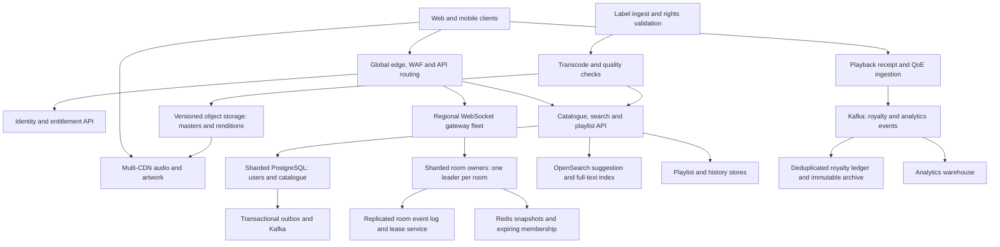

# Listen Together: scalable music streaming

Design proposal | 12 October 2026 | Six-page edition

## Page 1 - Scope and delivery architecture

Support 20 million monthly users, 2 million peak simultaneous listeners, 50 million tracks, and 200,000 peak active shared rooms, each with 2-5,000 members. These peaks are not independent maxima: if all listeners were in rooms, average occupancy would be ten. Not every room can have 5,000 listeners at the same time. The design separates audio bytes from small room-control messages; room servers never proxy the audio stream.

**Assumptions and targets (estimates, not measurements).** Average track length is four minutes. Three audio renditions at 64/128/256 kbps total about 13.4 MB per track, or 672 TB for 50 million tracks before replication, source masters and artwork. Peak 128 kbps audio egress is 256 Gbps before overhead, delivered by CDNs. Target playback-start p95 <2 seconds on healthy regional broadband; room synchronization p95 absolute drift <200 ms among supported, non-buffering clients. Bluetooth/output pipeline delays and suspended browsers prevent a universal audible guarantee. Instrument these separately.



Masters and immutable renditions live in multi-AZ object storage, with cross-region replicas and checksums. An asynchronous encoding pipeline produces aligned AAC/CMAF segments and HLS/DASH manifests, validates rights and technical quality, then publishes a version atomically. Clients fetch short-lived entitlement grants and signed CDN access, rather than caching personalized authorization responses. Track rights, region availability and key rotation remain server-enforced.

HLS provides segmented playlists and bitrate variants; see [RFC 8216](https://www.rfc-editor.org/rfc/rfc8216). The segment duration and bitrate ladder here are proposed settings.

Use 2-4 second media segments, common timeline/keyframe alignment across renditions, CDN origin shielding and immutable versioned cache keys. ABR picks a conservative first rendition and adapts from throughput plus buffer level. Prefetch manifest and first segment during queue preparation; maintain a modest buffer, cache artwork/metadata at edges, and offline audio only under explicit licensing. Multi-CDN steering reacts to error rate and startup latency; short-lived grants reduce repeated authorization calls without delaying entitlement revocation indefinitely.

---

## Page 2 - Catalogue and database decisions

Catalogue owns artists, albums, tracks, credits, availability windows and rendition references. Stable track IDs separate a recording from regional release versions. New-release ingest stages metadata and files, checks rights/transcode completion, commits a published version plus an outbox event, then refreshes search and caches. The API reads committed publication versions; unindexed new releases may lag in search but never point to unready audio. A reconciliation job repairs missed index updates and rights changes invalidate entitlement caches.

| Domain | Store and keys | Decision and consistency |
| --- | --- | --- |
| Users | PostgreSQL partitioned by user ID; unique identity index | Transactions for identity, subscription and entitlement relationships; replicas for safe reads. |
| Tracks, artists, albums | PostgreSQL catalogue shards; track ID primary key, album/artist indexes | Relational integrity and transactional publishing; cache popular records, keep bulk media outside SQL. |
| Playlists | PostgreSQL partitioned by owner; playlist ID and ordered item IDs | Versioned updates prevent lost edits; stable item IDs allow duplicates and reordering. |
| Listening history | Cassandra/DynamoDB-style wide-column store, user ID + month + time/event ID | Append-heavy time-range access with retention and bounded partitions; eventual reads are acceptable. |
| Active rooms | Replicated command log plus Redis snapshot keyed room ID | Log is durable authority; Redis accelerates recovery, not the only copy. Owner epoch prevents two writers. |
| Room membership | Redis expiring member/session records; durable room ACL in SQL | Heartbeats clear abandoned connections; authenticated identities drive votes and permissions. |
| Playback events | Kafka partitioned by room ID, plus room sequence and epoch | Ordered history/replay, idempotent application and checkpointed consumption. |
| Royalty events | Durable Kafka ingestion, immutable object archive, deduplicated SQL ledger | Financial reconciliation needs replay, audit and idempotency; analytics sampling is never used for royalties. |
| Analytics | Object lake and columnar warehouse (e.g. ClickHouse) | Large scans/aggregations isolated from live OLTP; sampled QoE permitted, audited counts distinct. |

Search-as-you-type uses OpenSearch edge n-grams/completion fields plus language-aware analyzers, popularity and regional rights filters. Debounce input around 150 ms, cancel stale requests, cap result size, and cache common prefixes briefly. Full search uses inverted indexes and separate ranking. Index updates come from the outbox/Kafka stream with catalogue version checks so old updates cannot overwrite new releases. A SQL fallback can serve exact track/artist lookups while recommendations/search are unavailable.

Kafka supplies a partitioned replicated log; room sequence/epoch and application deduplication remain our responsibility. See [Apache Kafka implementation](https://kafka.apache.org/41/implementation/).

Illustrative schema: `tracks(id, album_id, title, duration_ms, publication_version, rights_version)`, `track_artists(track_id, artist_id, role)`, `renditions(track_id, version, codec, bitrate, manifest_key)`, `playlists(id, owner_id, version)`, `playlist_items(playlist_id, item_id, ordinal, track_id)`. Room events include `(room_id, epoch, seq, request_id, type, payload, committed_at)`. Royalty records include `(event_id, user_pseudonym, track_id, territory, playback_session_id, audible_ms, received_at, policy_version)`. Index user playlist ownership and catalogue relation keys; partition append streams to avoid unbounded hot rows.

Personal data has explicit retention and deletion workflows. Royalty retention follows contractual/audit requirements rather than general analytics TTL. Services use least-privilege credentials, encryption in transit/at rest, no raw tokens in logs, and authenticated room permissions. Invite codes are high entropy; private rooms also require ACL checks. Shared playback requires each listener to have an appropriate track entitlement, never sharing the host's credential.

---

## Page 3 - Authoritative real-time synchronization

Each room has one regional owner, selected by directory mapping and a fenced lease. State is `{epoch, seq, trackId, queueVersion, paused, basePositionMs, effectiveAtServerMs, playbackRate}`. Commands carry authenticated user, unique request ID and expected queue/state version. The owner checks host pause/seek authority, validates track rights and membership, serializes commands, appends durably, then publishes. Stale epochs, old sequence numbers and repeated request IDs cannot apply twice. Versioned queue operations preserve deterministic ordering under concurrent additions; limit per-user additions and total queue length.

For playback at estimated server time T, expected position is `basePositionMs + (T - effectiveAtServerMs) * playbackRate` when playing, and `basePositionMs` when paused. Scheduled future commands must preserve the previous state until their effective time. A pause freezes the old timeline at its scheduled boundary. A seek resets base position at a future boundary. Track transitions prefetch the next item and schedule a start once; the control plane sends timestamps, not continuous audio or frame-by-frame ticks.

Clients ping the regional time endpoint over several samples, estimate offset from the midpoint of request/response, and prefer low-RTT samples to reduce asymmetry error. Use monotonic local timers with a calibrated server-time mapping; refresh periodically and on resume. NTP on servers bounds regional clock divergence, while owner failover preserves logical event ordering regardless of wall-clock adjustment.

Healthy clients schedule changes 300-500 ms ahead, with adaptive allowance for observed delivery percentiles. This creates a deliberate host-command delay to help large-room synchronization. New track starts may use a longer preparation window. Every few seconds compare local media position with the authoritative timeline: ignore small noise (<40 ms), gently adjust playback rate within about +/-2% for moderate drift, and seek for >200 ms persistent drift or discontinuities. These thresholds are tuning hypotheses. Output-device latency should be measured where APIs support it; media time alone does not prove audible synchrony.

Late joiners receive a snapshot plus last committed sequence, estimate server time, fetch the correct rendition, buffer and start at the current expected position. Apply only events after that snapshot. A sequence gap requests replay from retained log or a newer snapshot. Slow clients lower bitrate, skip ahead after rebuffering, and show a reconnecting/out-of-sync state instead of slowing all 5,000 listeners. If the browser blocks autoplay, the UI requires a user gesture. Offline clients may continue already-buffered audio briefly; stale controllers cannot mutate the room.

Vote-to-skip accepts one vote per authenticated member per track epoch. Define quorum as a majority of eligible active members snapshotted when voting begins, with membership debounce and host override to avoid a moving threshold. New joins do not retroactively count; disconnects have a short grace period. On quorum, append exactly one transition and reset votes for the next track. Repeated votes, client claims of vote totals and old-track votes are rejected. Large rooms use bounded member records and batched vote tally broadcasts.

---

## Page 4 - Pause fan-out to 5,000 listeners

The host request reaches its nearest gateway, which forwards to the room's home-region owner. One durable ordered event goes to gateway subscribers, and gateways fan it out to their local sockets. The owner does not synchronously await 5,000 acknowledgements. Clients acknowledge their highest sequence for recovery; aggregate receipt/drift telemetry by gateway and sample it independently from correctness.

```mermaid
sequenceDiagram
    participant H as Host
    participant G as Host gateway
    participant O as Room owner
    participant L as Replicated log
    participant F as Gateway fan-out fleet
    participant C as 5,000 clients
    H->>G: Pause(room, requestId, expectedVersion)
    G->>O: Authenticated host command
    O->>O: Check lease epoch, host role and dedupe
    O->>O: Freeze position at future effectiveAt
    O->>L: Append Pause(epoch, seq, position, effectiveAt)
    L-->>O: Quorum commit
    O-->>G: Accepted request and committed sequence
    G-->>H: Scheduled pause acknowledgement
    O->>F: Publish one committed event per subscribed gateway
    F->>C: WebSocket fan-out of epoch, seq and timestamp
    C->>C: Check sequence; schedule pause against clock offset
    C-->>F: Highest sequence acknowledgement and QoE sample
    alt Event arrives after effectiveAt or sequence gap
        C->>F: Request replay or snapshot
        F->>O: Fetch authoritative state
        O-->>C: Current frozen position and version
        C->>C: Pause and correct position immediately
    end
```

For example, twenty gateways serving 250 listeners each receive one 500-byte event, then collectively transmit roughly 2.5 MB of payload. This is an illustrative distribution, not a tested gateway limit. Repeated global controls are rate-limited. Backpressure drops obsolete presence/QoE updates first; playback commands stay ordered. A persistently slow connection receives a resync snapshot or reconnect instruction rather than an unlimited queue.

Horizontal scaling separates stateless HTTP APIs, socket gateways, and stateful room owners. Consistent hashing assigns virtual room partitions; hot rooms get dedicated ownership and a broader gateway fan-out tree. Scale gateways by live sockets/egress and owners by active rooms/event rate. Admission control maintains headroom for failover. Two million peak listeners imply up to two million sockets if everyone uses rooms; at an assumed 20,000 sockets/gateway, approximately 100 active gateways plus redundancy would be required. Validate socket count, TLS CPU, kernel limits and per-room fan-out under representative tests before provisioning.

Rooms are pinned to a home region for command ordering; geographically distant members connect through regional gateways forwarding to that owner. Audio remains local-CDN. Region assignment balances latency and rights. A globally dispersed room cannot achieve <200 ms on every path during congestion; measure region-pair distributions and communicate degraded status. Do not replicate independent active writers for the same room.

---

## Page 5 - Reliability, scaling and failure recovery

Room logs and ownership leases use a consensus-backed, multi-AZ service. Commands include owner epoch; the storage layer rejects writes from expired owners. A new owner restores snapshot plus committed tail and publishes a higher epoch. Clients discard previous-epoch commands and resynchronize. Audio may continue at its last known timeline while control recovers; after recovery schedule a consistent correction boundary. Target node failover <5 seconds is a proposed SLO, not an observed result.

| Failure scenario | Recovery and user effect |
| --- | --- |
| Room owner dies after committing pause, before broadcasting | New fenced owner replays committed log; gateways dedupe sequence, resend after last ack, and obtain snapshot if retention expired. |
| Gateway process/network fails | Clients reconnect with jitter to another gateway, authenticate, send epoch/last sequence, and recover state; audio continues if buffered. |
| Redis snapshot/member cache unavailable | Rebuild room state from durable log and membership from authenticated heartbeats; throttle room creation and presence traffic while caches recover. |
| Entire home region fails | Fence old ownership before a new region accepts commands. Promote from durable replica; publish new epoch. Cross-region asynchronous replica can lose recent controls (explicit RPO <=5 s target); clients resync. No quorum means temporary read-only room control, not split brain. |
| CDN/origin degradation | Steer to healthy CDN/replica, retry with jitter and lower bitrate. Cached existing tracks continue; disable unavailable new starts rather than retry storms. |
| Kafka/royalty pipeline slows | Durable ingestion spools with bounded storage, alerts on backlog and retries. Never drop paid-play evidence silently; stop accepting new sessions if evidence cannot be durably recorded. |
| Search/index outage or stale publication | Exact catalogue reads and existing queues still work; suggestion/recommendation features degrade; outbox replay and version reconciliation repair the index. |
| Clock jump, suspended tab or prolonged buffering | Refresh clock offset and snapshot, discard stale schedules, lower bitrate and seek to authoritative position when ready. |

For regional failure, choose availability tradeoffs explicitly. Durable room logs replicate synchronously across local zones and asynchronously to a standby region; thus regional control RPO is nonzero. Require a strongly consistent global ownership/fencing record before promotion. If zero-loss regional room controls are mandatory, use cross-region consensus at increased control latency. Royalty acknowledgements require durable replicated receipt and an immutable retryable client event ID; reconcile receipts after disaster recovery. Any paid evidence RPO requirement must be matched by the selected storage replication contract.

Deploy stateless services by canary, with rollback on startup/drift/error regressions. Gateways stop accepting new sockets, provide reconnect hints and drain gradually. Room owners transfer a partition by checkpointing, relinquishing its lease and waiting for the new owner to announce an epoch; old owners cannot write. Support old and new event schemas concurrently during rollout. Limit simultaneous drains, jitter reconnects and retain event tails beyond the reconnect window.

Use circuit breakers, timeout budgets and bounded queues. When overloaded, preserve already-playing audio and core pause/seek/queue control; reduce presence, analytics sampling and recommendations first. Rate-limit queue additions and room creation. Track hot partitions and proactively move rooms using fenced handoff. Back up SQL, test point-in-time restore and regularly practice zone/region failure with load rather than assuming replicas imply recovery.

---

## Page 6 - Observability, alternatives and build plan

| Metric | Definition and initial objective (proposed) |
| --- | --- |
| Synchronization drift | Absolute client media-position minus authoritative position; p50/p95/p99 by region, room size and device. p95 <200 ms for healthy playing clients; report buffering/suspended clients separately, never hide their rate. |
| Startup latency | User play intent to first decoded/audible frame, excluding explicit autoplay permission wait; p95 <2 s on supported broadband. |
| Buffering | Rebuffer seconds / requested listening seconds, stall count/session and client eligibility; initial target <1% aggregate with per-cohort tails. |
| Room delivery latency | Durable commit to client receipt using clock estimate, and receipt-to-application; p95 <150 ms within region, monitor cross-region separately. |
| Reconnection | Successful restored identity/state within 10 s / eligible reconnect attempts; initial target >99%. |
| Availability | Successful authenticated playback/control operations over total valid requests; proposed 99.95% monthly for core services, measured separately. |
| CDN performance | Cache hit ratio by byte/request, TTFB, 4xx/5xx, origin egress, ABR switch rates and rendition throughput; alert on regression from regional baseline. |

Also monitor event-loop lag, gateway backpressure, reconnect storms, owner lease conflicts, log commit p99, replication lag, Redis evictions, search freshness, royalty dedupe/reconciliation discrepancies and spend. Use request IDs across host command, commit, gateway delivery and client application; sample distributed traces and QoE while avoiding room/user IDs as unbounded metric labels. Maintain unsampled error counters and durable financial records. Synthetic multi-region rooms continuously play, pause, seek and verify state. Device-lab tests measure audible drift; media-position telemetry is an imperfect proxy.

**Alternatives rejected.** Sending audio through room servers couples expensive byte delivery to control fan-out; use CDN. Peer-to-peer/WebRTC room audio introduces 5,000-member mesh/SFU cost, host uplink dependence and rights complications; clients independently fetch licensed media. Client-authoritative host state cannot survive host exit securely and makes ordering inconsistent. Redis pub/sub alone loses committed controls on failure; use a durable log and snapshots. Active-active writers within one room complicate seek/pause conflicts; one fenced leader is easier to verify. One SQL table for all listening events creates write/index pressure and analytical interference. A global synchronous owner for every room improves consistency but pays unnecessary intercontinental latency; use regional home ownership and explicit failover policy.

**Three-developer first release.** Developer A builds ingest/catalogue/entitlements with one managed SQL service, object storage and CDN. Developer B builds authenticated small-room membership, fenced room owner, durable state/events, shared queue and votes. Developer C builds player integration, clock estimation, scheduled pause/seek, late joining and drift telemetry. Pair on protocol contracts and threat review. Start with one region, 2-20 member rooms, three aligned renditions, managed search and basic QoE dashboards. Include durable royalty event IDs and reconciliation from the first release; postponing financial correctness makes later repair difficult.

Release gates: deterministic tests for queue/votes/retries and epoch fencing; clock/skew simulations; browsers under jitter/loss; audible drift measurements; 5,000-client control fan-out; owner kill after commit; regional recovery exercise; ingestion/rights revocation tests. Ramp load based on measured SLOs and cost. The 20M/2M scale is a design target, not a claim that three people have implemented and benchmarked it.

Postpone personalized recommendations, podcasts, lossless audio, social graph, collaborative offline edits, multi-region active ownership and 5,000-person public rooms until small-room correctness and capacity are measured. Expand to large rooms by testing gateway fan-out and hot ownership; add multi-CDN and regional standby before committing to peak availability. No benchmark results are invented in this proposal.
